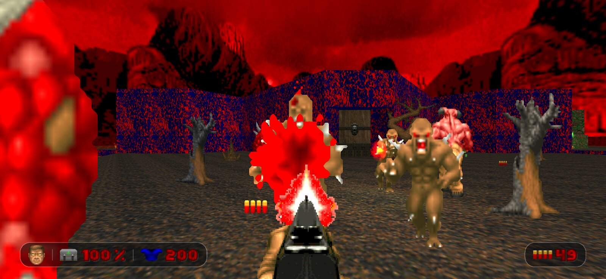
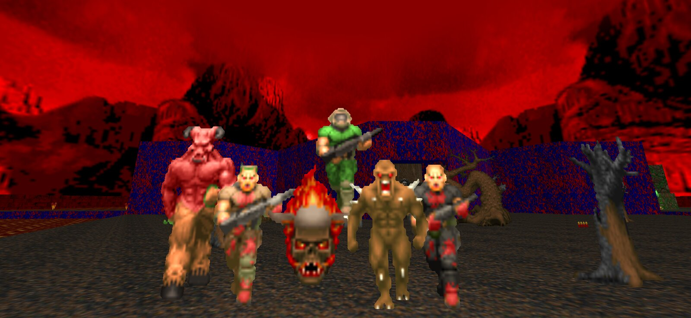
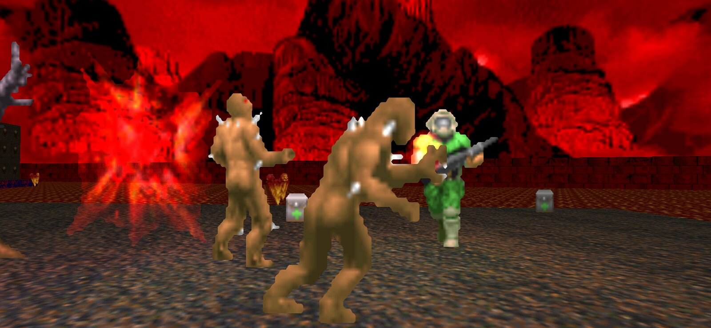
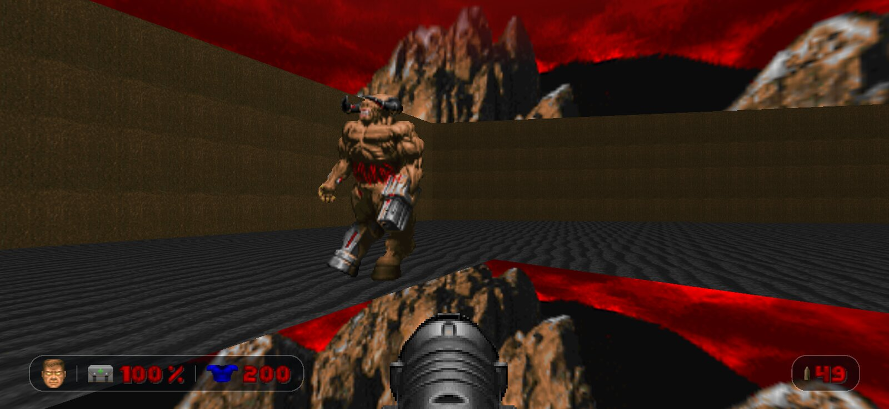
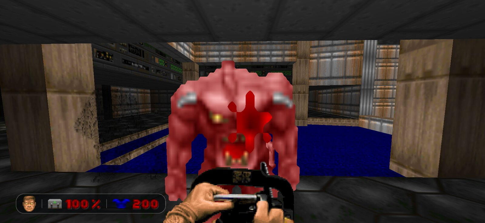
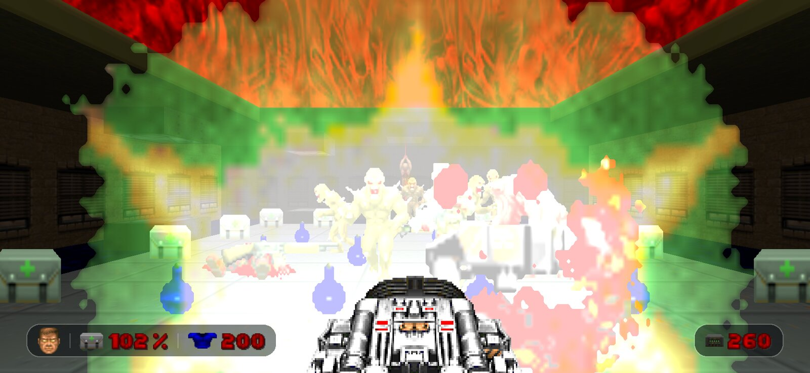
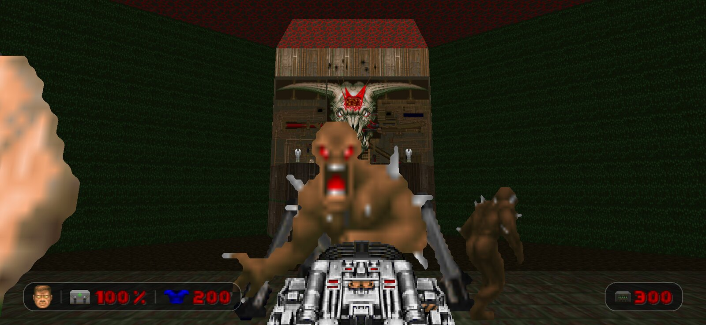
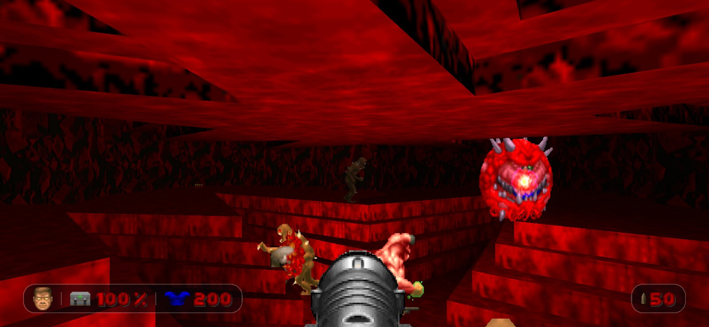
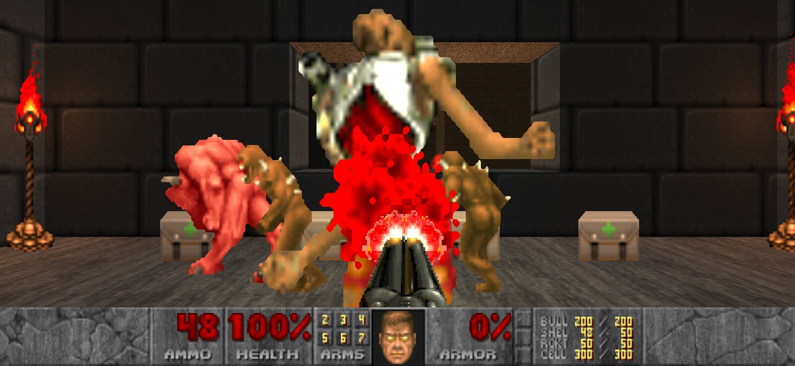

# DOOM and DOOM II for iPhone and iPad (UZDoom)

Play **The Ultimate DOOM**, **DOOM II**, **Final DOOM** (TNT: Evilution and The Plutonia Experiment) and their add-ons on iPhone and iPad, with touch controls. It's an unofficial port of [UZDoom](https://github.com/UZDoom/UZDoom), the open-source DOOM engine that carries on ZDoom and GZDoom.



**You need your own copy of DOOM. Game files are not included.** The **DOOM + DOOM II** re-release on [Steam](https://store.steampowered.com/app/2280/DOOM__DOOM_II/) or [GOG](https://www.gog.com/game/doom_doom_ii) has every game the app plays; the classic .wad files from older editions work too. You copy the files to your iPhone or iPad yourself.

## Install

You need an iPhone or iPad with iOS 15 or newer. The app isn't on the App Store, so you install it yourself ("sideloading"). Pick one way:

- **SideStore or AltStore (easiest).** On your iPhone, tap **[Add to SideStore](https://sithewok13-dev.github.io/doom/#add-sidestore)** or **[Add to AltStore](https://sithewok13-dev.github.io/doom/#add-altstore)**, then install DOOM from there. Updates come the same way.
- **Feather, Sideloadly or another signing tool.** Download `DOOM.ipa` from the [releases page](https://github.com/sithewok13-dev/UZDoom/releases) and sign it with your tool.
- **The source by hand.** In SideStore, AltStore or Feather, go to *Sources*, tap **+**, and paste this address:

  ```
  https://raw.githubusercontent.com/sithewok13-dev/UZDoom/ios/packaging/ios/altstore-source.json
  ```

Then open DOOM once (it says no game files were found: that's expected), and copy your `.wad` files (`doom.wad`, `doom2.wad`, `tnt.wad`, `plutonia.wad`, and add-ons such as `sigil.wad` or `nerve.wad`) into **Files > On My iPhone > DOOM**. Open DOOM again and tap a game. The [release notes](https://github.com/sithewok13-dev/UZDoom/blob/ios/docs/ios/RELEASE_NOTES.md) have every step and every control.

AltStore here means AltStore Classic; AltStore PAL can't install it.

## Cool features

- **Touch controls made for DOOM:** a move stick wherever your thumb lands, drag anywhere to look, FIRE with USE, JUMP and CROUCH around it.
- **A weapon wheel:** slide off NEXT WPN or PREV WPN and your whole arsenal fans out, with the game's own pictures and ammo.
- **A game picker:** cards for DOOM, DOOM II, TNT and PLUTONIA, each with a monster from your own game files, and the add-ons SIGIL, SIGIL II, No Rest for the Living, The Master Levels and Legacy of Rust.
- **Six HUD looks:** DOOM's classic status bar, cut-down versions of it, or small modern pills with the doomguy's face, in three sizes.
- **A camera:** photos, bursts, and selfies where the doomguy poses with the nearest monsters. **Action Freeze** stops time so you can fly round a fight.
- **The sithewok cheat:** god mode and every weapon, a cheat menu of DOOM's own cheats (Noclip, Full map, Berserk and more), and **LEVEL** to jump to any map.
- **Tilt aiming**, **60 or 120 frames a second**, and **Vulkan** graphics on Metal.
- **LAN co-op and deathmatch** for up to 8 players on the same Wi-Fi (new, see below).

## Sorry about the bugs

This is an unofficial beta, so please expect bugs, and back up your saves. **Multiplayer may well be broken:** LAN games are brand new and have only been tried on a computer, never between two iPhones yet. Sorry, it's being worked on. iPads have never been tried either.

Found a bug? Please [report it here](https://github.com/sithewok13-dev/UZDoom/issues), not to upstream UZDoom, and say which build you have (it's under the MENU tray).

<p>








</p>

*All the pictures come from this port's game code running on a computer with real game files, not from an iPhone, so they show no touch buttons. The selfie and Action Freeze shots were taken with the port's own camera.*

## Thanks

This port stands on the work of many people. Thank you to:

- **[id Software](https://www.idsoftware.com/)**, for DOOM and DOOM II, and for releasing DOOM's source code in 1997.
- **Marisa "Randi" Heit**, who created [ZDoom](https://github.com/rheit/zdoom); **Christoph "Graf Zahl" Oelckers**, who created [GZDoom](https://github.com/ZDoom/gzdoom); **Rachael "Eruanna" Alexanderson** and everyone who has kept GZDoom and now **[UZDoom](https://github.com/UZDoom/UZDoom)** going; and every name in [CONTRIBUTORS](https://github.com/UZDoom/UZDoom/blob/trunk/CONTRIBUTORS).
- **[SDL](https://www.libsdl.org/)** (Sam Lantinga and contributors), **[MoltenVK](https://github.com/KhronosGroup/MoltenVK)** (the Khronos Group and contributors), **[OpenAL Soft](https://openal-soft.org/)** (Chris Robinson), FluidSynth, libsndfile and libvpx.
- **Nightdive Studios** and id Software for the re-release, and **John Romero** for SIGIL and SIGIL II.

UZDoom and this port are free software under the GNU GPL, version 3 or later. Not affiliated with or endorsed by id Software, Bethesda, Nightdive Studios or the UZDoom team, and not an official UZDoom release. DOOM is a trademark of id Software.

---

*The rest of this page is upstream UZDoom's README, by the UZDoom team and contributors, from [UZDoom/UZDoom](https://github.com/UZDoom/UZDoom). Its links point to upstream; for the iOS port, see above.*

<div align="center">

[  ][repo]

</div>

## Welcome to UZDoom!

[![Continuous Integration][badge_git]][status_git]
[![Engine Translation status][badge_trans]][status_trans]
[![Game Translation status][badge_trans_games]][status_trans_games]

**UZDoom** is a modern, feature-rich source port for the classic game **DOOM**.

A continuation of [ZDoom][zdoom] and [GZDoom][gzdoom], UZDoom enhances the original DOOM engine, providing advanced features like:

* High-Resolution Graphics
* Dynamic lighting
* 3D Floors
* Extensive Modding Support
* Support for modern OpenGL and Vulkan renderers

UZDoom is **free and open-source software**, built and maintained by a dedicated community of developers and enthusiasts.

## 🙏 Acknowledgments

UZDoom would not be possible without the foundational work of many people. We extend our immense gratitude to:

* **id Software** for creating the original DOOM and releasing its source code.
* **Marisa Heit** for her foundational work on ZDoom, and **Christoph Oelckers** for his work on GZDoom.
* The countless modders, mappers, and artists in the DOOM community who continue to create amazing content.
* All the contributors who have submitted code, reported bugs, and helped improve the project over the years.

The **UZDoom Icon** was designed by **Carlos "Cardboard Marty" Sanchez**, copyrighted to the UZDoom Team, and licensed under **Creative Commons BY-SA 4.0**.

See the [CONTRIBUTORS](CONTRIBUTORS) file for a full list of code contributors.

## 📄 Legal

UZDoom is licensed under the **GNU General Public License (GPL) version 3 or any later version (GPLv3+)**.

This program is distributed in the hope that it will be useful, but **WITHOUT ANY WARRANTY**. See the GNU General Public License for more details.

You can view the full license text here: <https://www.gnu.org/licenses/>

**Copyrights:**
* Copyright 1993-1996 id Software
* Copyright 1999-2016 Marisa Heit
* Copyright 2002-2016 Christoph Oelckers
* Copyright 2017-2025 GZDoom Maintainers and Contributors
* Copyright 2025-2026 UZDoom Maintainers and Contributors

## 🌐 Resources

* [Home Page][home]
* [Wiki][wiki]
* [Discord Server][community]
* [Forum][forum]
* [Engine Translation][status_trans]
* [Game Translation][status_trans_games]

### 🛠️ Building UZDoom

To build UZDoom from source, please see UZDoom's GitHub [wiki][gh_wiki] for a full list of dependencies and detailed instructions. Build For [Linux][gh_linux] / [Windows][gh_windows] / [MacOS][gh_apple]

<div align="center">

[  ][repo]

[][status_trans]
[][status_trans_games]

</div>

[gzdoom]: https://github.com/ZDoom/gzdoom/
[zdoom]: https://github.com/rheit/zdoom/

[repo]: https://github.com/UZDoom/UZDoom/
[home]: https://zdoom.org/
[wiki]: https://zdoom.org/wiki/
[forum]: https://forum.zdoom.org/
[community]: https://dsc.gg/zdoom

[gh_wiki]: https://github.com/UZDoom/UZDoom/wiki/
[gh_linux]: https://github.com/UZDoom/UZDoom/wiki/Compilation#linux
[gh_windows]: https://github.com/UZDoom/UZDoom/wiki/Compilation#windows
[gh_apple]: https://github.com/UZDoom/UZDoom/wiki/Compilation#macos

[status_git]: https://github.com/UZDoom/UZDoom/actions/workflows/continuous_integration.yml
[badge_git]: https://github.com/UZDoom/UZDoom/actions/workflows/continuous_integration.yml/badge.svg

[badge_trans]: https://hosted.weblate.org/widget/uzdoom/svg-badge.svg
[status_trans]: https://hosted.weblate.org/engage/uzdoom/

[badge_trans_games]: https://hosted.weblate.org/widget/doom-engine-games/svg-badge.svg
[status_trans_games]: https://hosted.weblate.org/engage/doom-engine-games/
